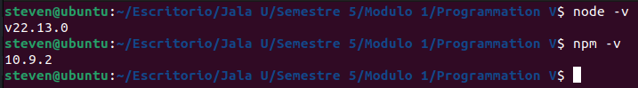
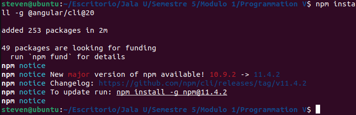
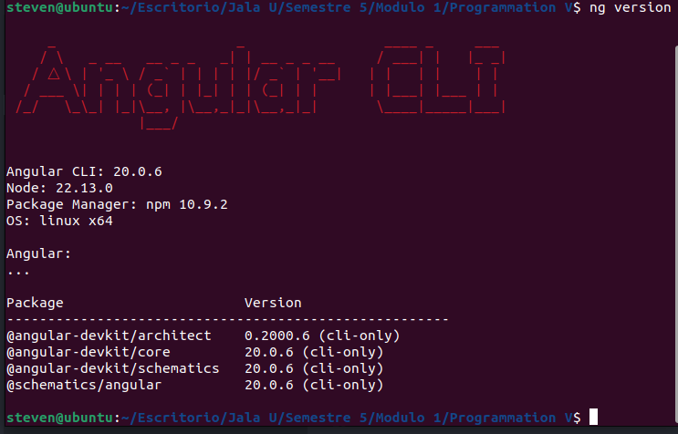
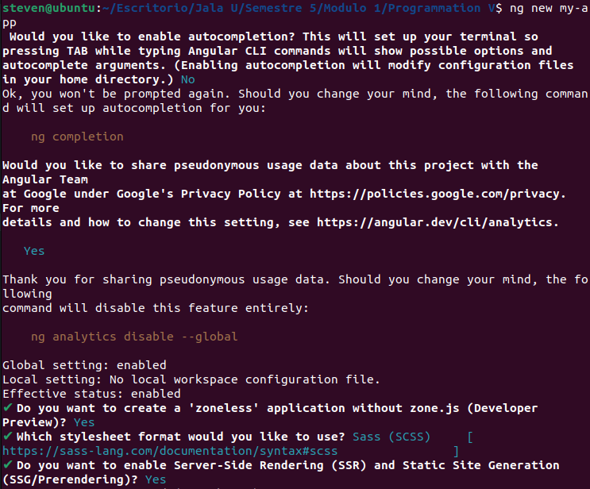
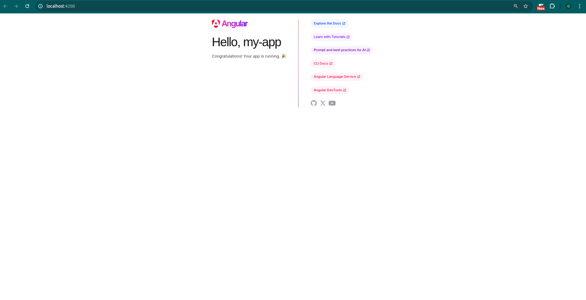

# 2. Instalación de Angular CLI 

De acuerdo a la documentación de la página oficial, para instalar Angular CLI versión 20.x. debemos contar con una versión de node js de ^20.19.0 (>=20.19.0 y <21.0.0) || ^22.12.0 (>=22.12.0 y <23.0.0) || ^24.0.0 (>=24.0.0 y <25.0.0) y una versión de npm de "^9.15.6" (>=9.15.6), por lo tanto, antes de instalar el Angular CLI vamos a confirmar la versión de nuestro node y la versión de nuestro npm con los comandos `node -v` y `npm -v`:

### Resultado:



Una vez confirmado los requisitos minimos vamos a ejecutar el siguiente comando para instalar la versión 20:

```bash
npm install -g @angular/cli@20
```

### Resultado:



Después de la instalación nos aseguramos de que Angular CLI haya sido instalado correctamente con el comando:

```bash
ng version
```

### Resultado:



# Crear un espacio de trabajo y una aplicación inicial

Una vez hecha y confirmada la instalación vamos a crear un espacio de trabajo para inciar una aplicación en Angular, para ello vamos a ejecutar el siguiente comando `ng new my-app`.



*Acá respondemos a las preguntas que vaya haciendo el sistema y en `Which stylesheet format would you like to use?` escogemos **Sass (SCSS)** para que sea nuestro preprocesador de estilos.*

Una vez creado corremos el servidor con el comando `ng serve --open`.

# Resultado



# Referencias

- https://angular.dev/reference/versions
- https://angular.dev/tools/cli/setup-local#install-the-angular-cli
- https://angular.dev/tools/cli/setup-local#create-a-workspace-and-initial-application