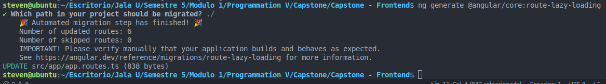
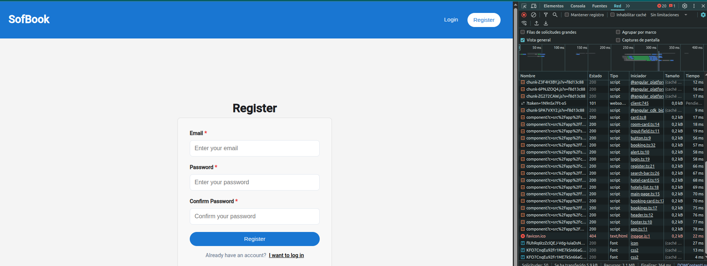
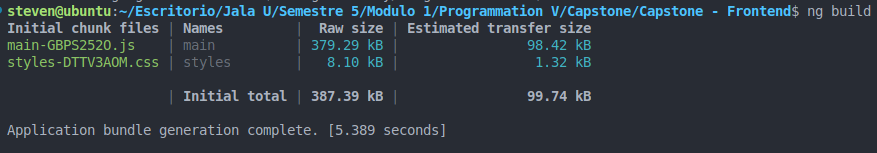
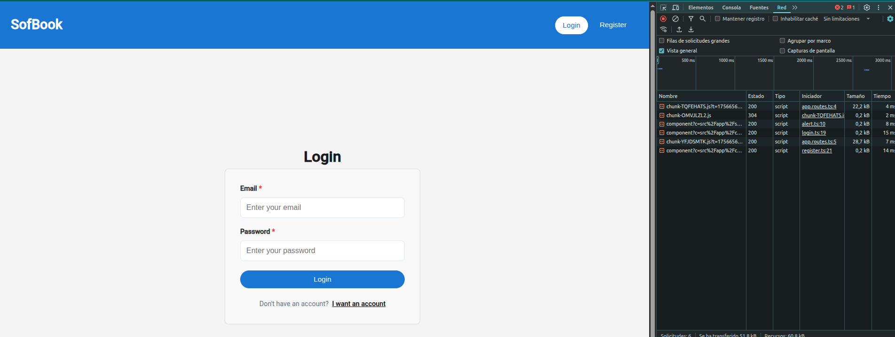
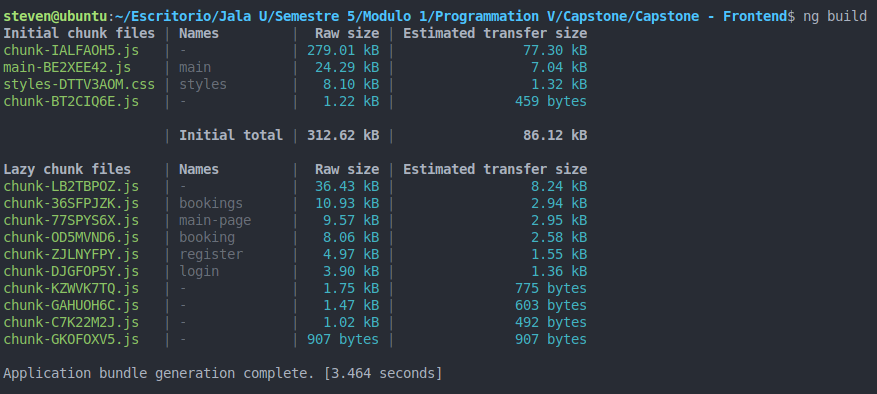

## What is Lazy Loading

Lazy loading is a strategy used to optimize the loading time of an Angular application by loading modules only when they are required. Instead of loading all modules and their associated components at once during the initial application load, lazy loading allows modules to be loaded asynchronously as the user navigates to the corresponding routes. This results in faster initial load times and improved overall performance, especially for larger applications with complex routing structures.

## Why use Lazy Loading

It offers several benefits, which includes:

- Improved initial load time: By loading only the required components initially, the application's initial load time is reduced which results in a better user experience.
- Reduced memory footprint: Since only the required components are loaded, the application's memory footprint is smaller, leading to better overall performance.
- Better code organization: It encourages modular code organization, making it easier to maintain and scale the application.
It plays a crucial role in optimizing Angular applications for speed performance, and scalability, which enhances user experience.

## Lazy Loading Configuration

We can use this command to do the migration:

```bash
ng generate @angular/core:route-lazy-loading
```



## Without Lazy Loading

This is how it would run on our server:



When we run the command `ng build`, Angular bundles most of the application code into the main file (`main.js`). Since we are not using lazy loading, all modules and components are included upfront, even if the user never navigates to them.



### Results

- **Initial total (387.39 kB):** This is the total size of the JavaScript, CSS, and other assets needed for the initial load of the Angular app.
- **Compressed total (99.74 kB):** This is the gzipped or brotli-compressed size of those same assets.
- **Application bundle generation complete [5.389 seconds]:** This is the time Angular took to compile, optimize, and bundle the app

## With Lazy Loading

This is how it would run on our server:



With the command `ng build` we can see the output of our build process, the components are loaded into different output file each so that they can be served only when required.




### Results

- **Initial total (312.62 kB):** This is the total size of the JavaScript, CSS, and other assets needed for the initial load of the Angular app.
- **Compressed total ( 86.12 kB):** This is the gzipped or brotli-compressed size of those same assets.
- **Application bundle generation complete. [3.464 seconds]** This is the time Angular took to compile, optimize, and bundle the app

### Difference I found

| Feature              | Without Lazy Loading | With Lazy Loading |
| -------------------- | -------------------- | ----------------- |
| **Initial bundle**   | 387 kB               | 312 kB            |
| **Initial transfer** | 99.74 kB             | 86.12 kB          |
| **Build time**       | 5.38 s               | 3.46 s            |

## Resources

- https://angular.dev/reference/migrations/route-lazy-loading
- https://www.geeksforgeeks.org/angular-js/implementing-lazy-loading-in-angular/
- https://angular.dev/cli/build
- https://medium.com/@HenryGBC/c%C3%B3mo-implementar-lazy-loading-en-angular-74b6e85d021f