## What is Flexbox and its properties

CSS Flexbox is the layout model designed to create flexible and responsive layout structures without using float or positioning. By applying display: flex to a parent container, it becomes a flex container, and its children become flex items. This allows control over the items' growth, shrinkage, and space distribution.

Apply a display type of flexbox to the parent container, this would make all the child elements in it to adjust into the flex type and these would be called the " flex items ". This means they have become more flexible. we can control how much they can shrink and how much they can grow and also the spacing between these elements.

- Display: flex: Applies flexbox to the parent container, making child elements flex items.
- Flex Items: Flexible elements that can grow, shrink, and adjust spacing.

```html
<body>
    <div class="container">
        <div class="item item-1">1</div>
        <div class="item item-2">2</div>
        <div class="item item-3">3</div>
        <div class="item item-4">4</div>
    </div>
</body>
```

```css
.container { 
  display: flex;
  border: 5px solid rgb(0, 0, 0);
  background-color: rgb(245 197 221);
}
.item {
  border: 5px solid rgb(0, 0, 0);
  background-color: rgb(141, 178, 226);
  margin: 10px;
  padding: 20px;
  height: 100px;
  width: 100px;
  font-weight: bold;
  font-size: 45px;
}
```

- The flex container can change the width, height and order of the child elements.
- Items can grow or shrink to fill the available space or to prevent overflow.
- Available space is distributed among other items.
- Direction of flex items: 
  
  - flex-direction: row (left-to-right)
- 
  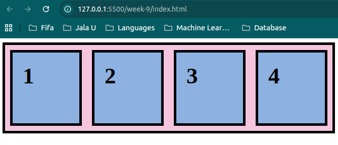

  - flex-direction: row-reverse (right-to-left)
  
  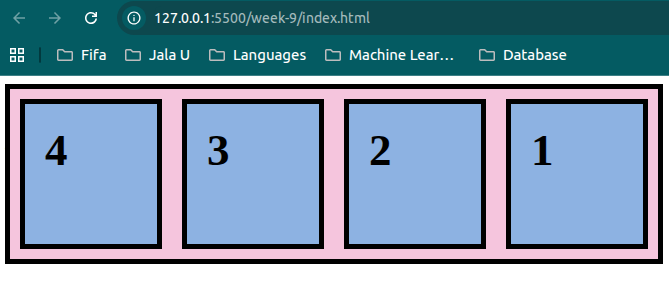

  - flex-direction: colum (top-to-bottom)
  
  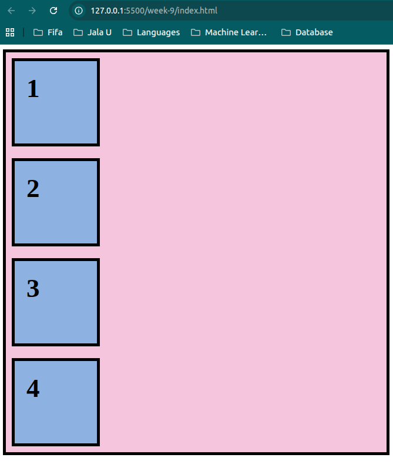

  - flex-direction: colum-reverse (bottom-to-top)
  
  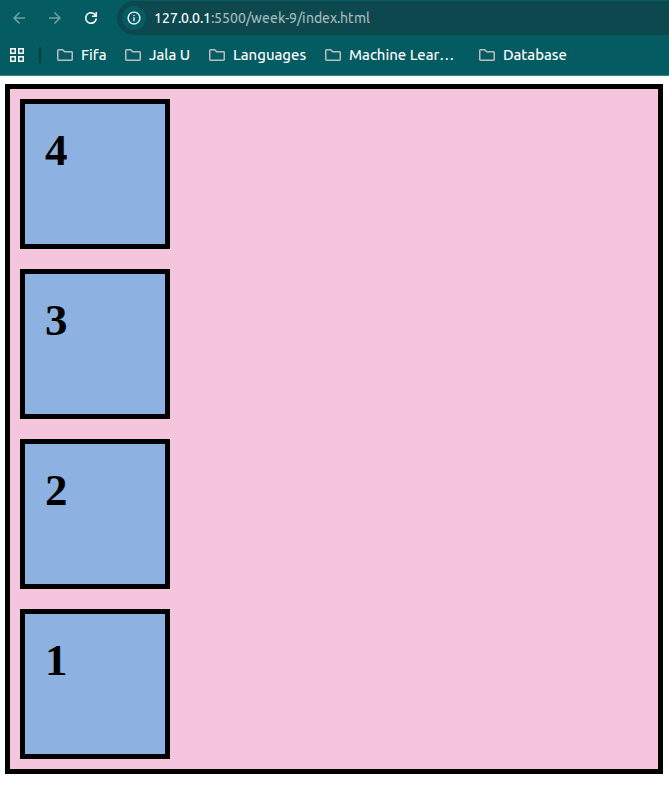
  
### Flexbox Properties:

- **display:** Defines a flex container.
- **flex-direction:** Defines the main axis direction.
- **flex-wrap:** Allows items to wrap onto multiple lines.

```css
.container {
  display: flex;
  flex-wrap: wrap;
  border: 5px solid rgb(0, 0, 0);
  background-color: rgb(245 197 221);
}
```

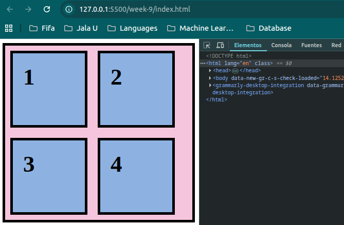

- **flex-flow:** Shorthand for flex-direction and flex-wrap.

```css
.container {
  display: flex;
  flex-flow: row wrap;
  border: 5px solid rgb(0, 0, 0);
  background-color: rgb(245 197 221);
}
```
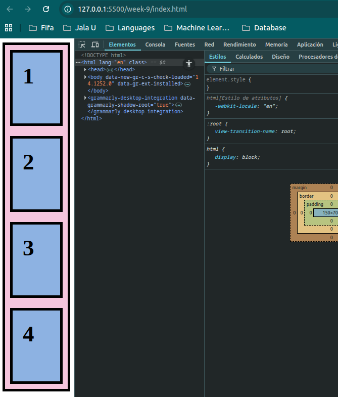

- **justify-content:** Aligns items along the main axis.

```css
.container {
  display: flex;
  justify-content: center;
  border: 5px solid rgb(0, 0, 0);
  background-color: rgb(245 197 221);
}
```

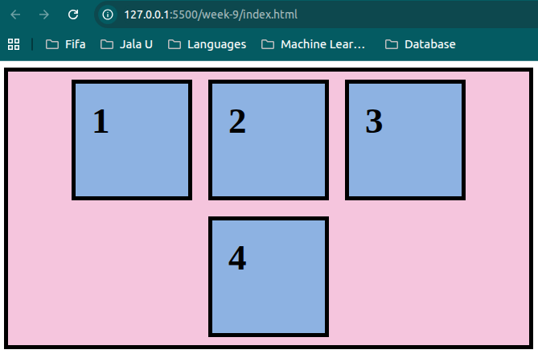

- **align-content:** Aligns items along the cross axis.

```css
.container {
  display: flex;
  align-content: center;
  border: 5px solid rgb(0, 0, 0);
  background-color: rgb(245 197 221);
}
```

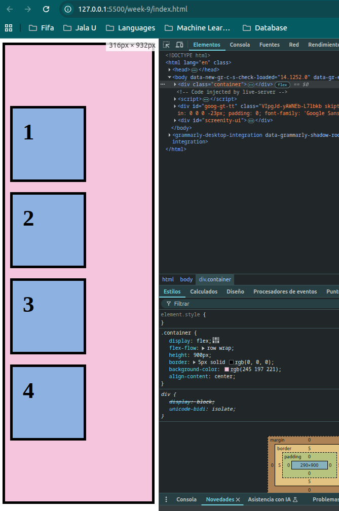

- **align-items:** Aligns multiple lines of items on the cross axis.

```css
.container {
  display: flex;
  align-items: center;
  border: 5px solid rgb(0, 0, 0);
  background-color: rgb(245 197 221);
}
```

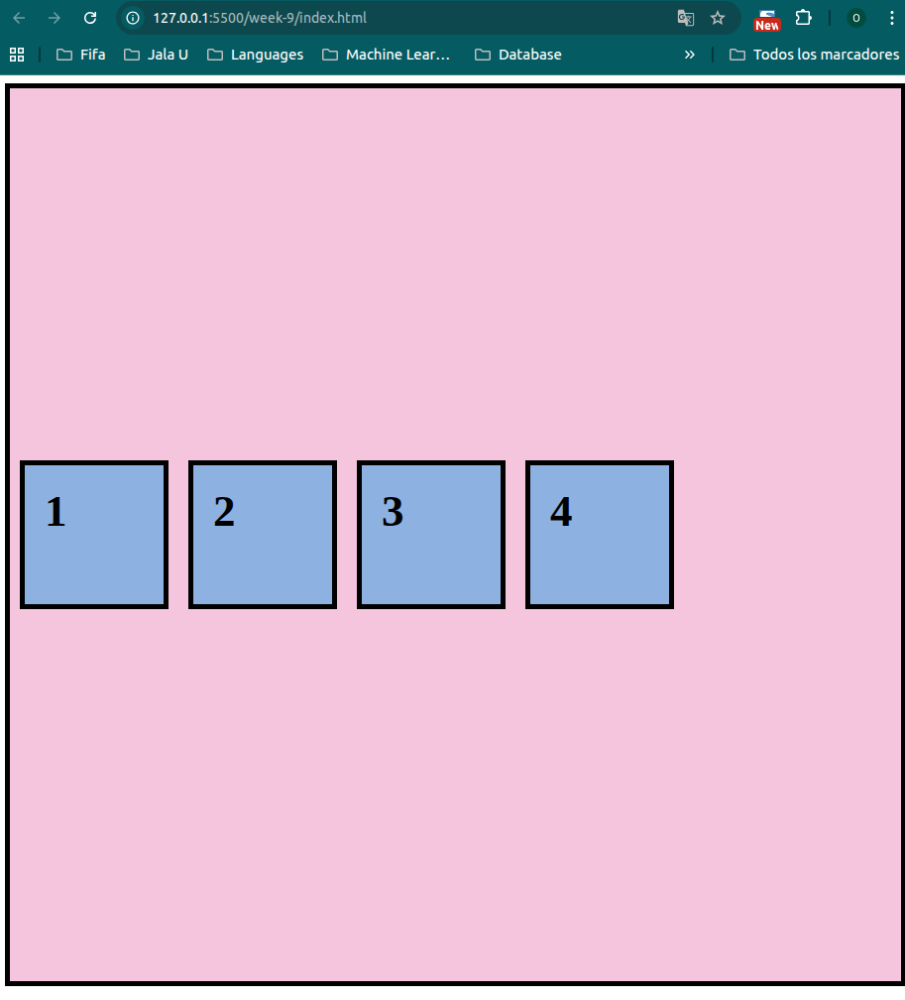

2. Children/Flex-items Properties:

- **order:** Changes the order of items without altering the source order.

```css
.item-1 {
  order: 3; 
}

.item-2 {
  order: 1; 
}

.item-3 {
  order: 2; 
}

.item-4 {
  order: 4; 
}
```

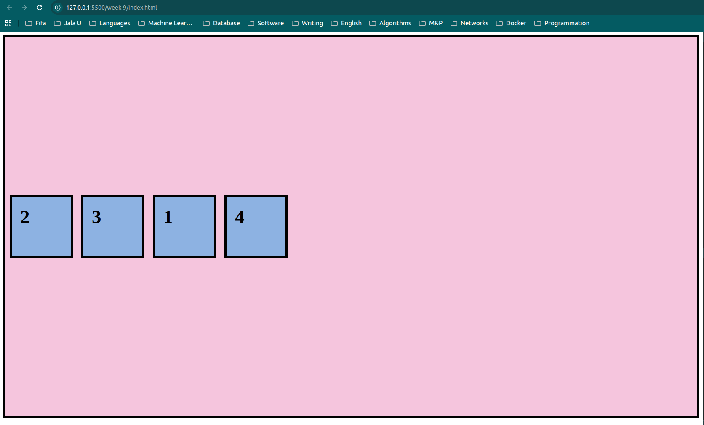

- **flex-grow:** Allows an item to grow to fill available space.

```css
.item-1 {
  flex-grow: 1;
  order: 3; 
}
```

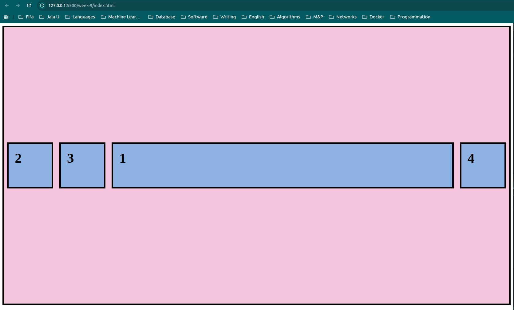

- **flex-shrink:** Allows an item to shrink if there's insufficient space.

```css
.item-4 {
  flex-shrink: 0; 
}
```

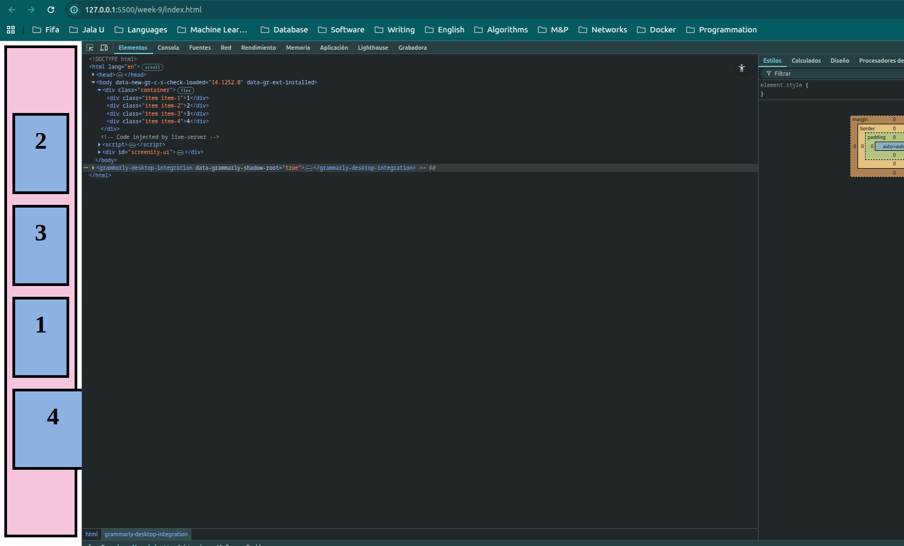

- **flex-basis:** Defines the initial size of an item.

```css
.item-1 {
  flex-basis: 200px;
}
```

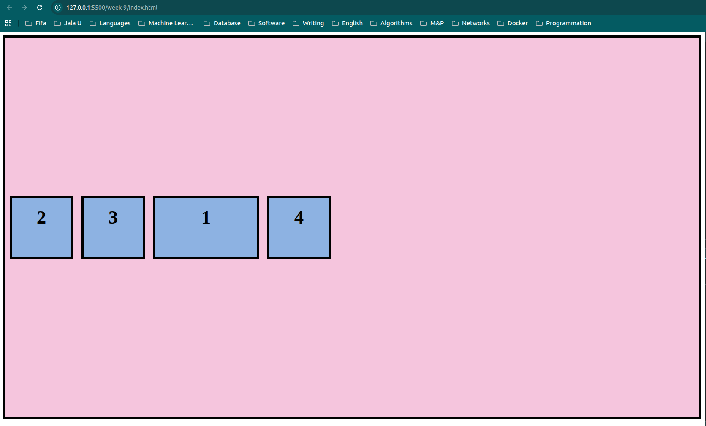

- **flex:** Shorthand for flex-grow , flex-shrink , and flex-basis .

```css
.item-1 {
  order: 3;
  flex: 1 0 130px;
}
```
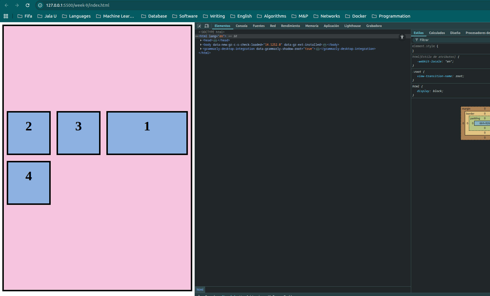

- **align-self:** Aligns a single item within the flex container.

```css
.item-1 {
  align-self: flex-start;
}

.item-2 {
  align-self: flex-end;
}

.item-3 {
  align-self: center;
}

.item-4 {
  align-self: stretch;
}
```

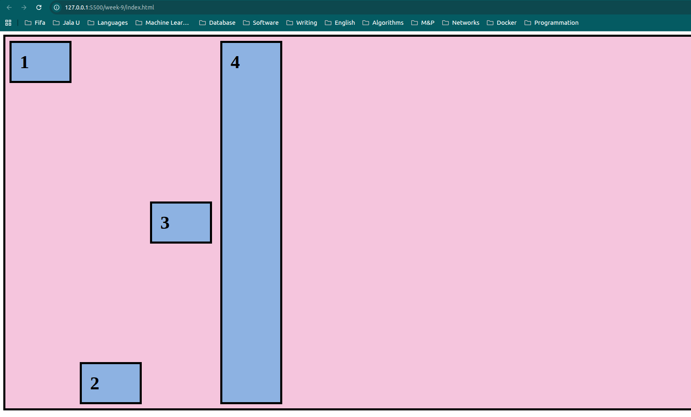

### Example in the project

Search bar with flexbox for entries:

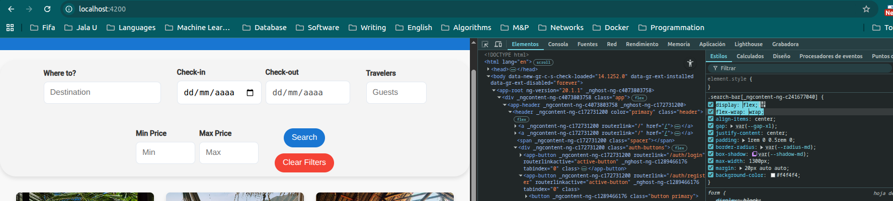


## What is CSS Grid and its properties

CSS Grid is a two-dimensional layout system designed to handle both rows and columns. By applying `display: grid` to a parent container, it becomes a grid container, and its children become grid items. This allows precise control over how elements are sized and positioned in rows and columns.

Apply a display type of grid to the parent container, and all the child elements in it become "grid items". This means we can control their size, placement, and alignment inside a structured grid.

* **Display: grid**: Applies grid to the parent container, making child elements grid items.
* **Grid Items**: Elements that are positioned in a structured row/column layout.

```html
<body>
  <div class="container">
    <div class="item item-1">1</div>
    <div class="item item-2">2</div>
    <div class="item item-3">3</div>
    <div class="item item-4">4</div>
  </div>
</body>
```

```css
.container { 
  display: grid;
  border: 5px solid rgb(0, 0, 0);
  background-color: rgb(245 197 221);
  grid-template-columns: repeat(2, 150px);
  grid-template-rows: repeat(2, 150px);   
  gap: 10px; 
}
.item {
  border: 5px solid rgb(0, 0, 0);
  background-color: rgb(141, 178, 226);
  margin: 5px;
  font-weight: bold;
  font-size: 45px;
  display: flex;
  justify-content: center;
  align-items: center;
}
```

* The grid container defines both rows and columns.
* Items can span across multiple rows or columns.
* Available space can be distributed using **fractions (`fr`)**.
* Grid alignment can be controlled at both container and item level.


### Grid Container Properties

* **grid-template-columns / grid-template-rows**: Defines the number and size of columns/rows.

```css
.container {
  display: grid;
  grid-template-columns: 100px 200px;
  grid-template-rows: 150px 150px;
}
```

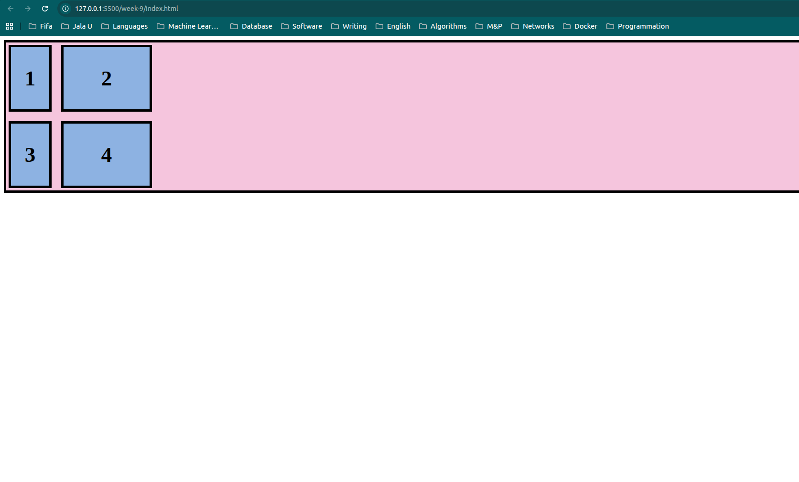


* **repeat()**: Repeats a pattern for columns/rows.

```css
.container {
  display: grid;
  grid-template-columns: repeat(3, 1fr); 
}
```

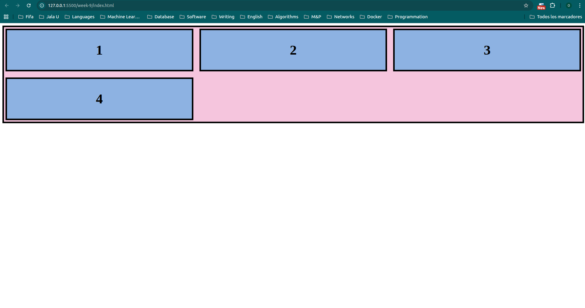

* **fr unit**: Represents a fraction of available space.

```css
.container {
  display: grid;
  grid-template-columns: 2fr 1fr 1fr; 
}
```

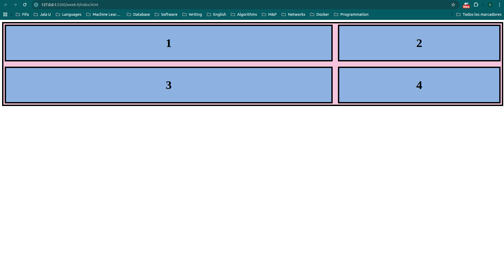

* **gap / row-gap / column-gap**: Defines spacing between items.

```css
.container {
  display: grid;
  grid-template-columns: repeat(2, 150px);
  gap: 50px;
}
```

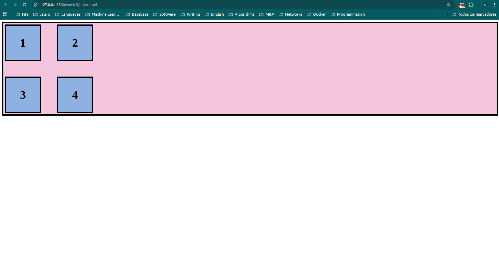

* **justify-items**: Aligns items inside their cells horizontally.

```css
.container {
  display: grid;
  justify-items: center;
}
```

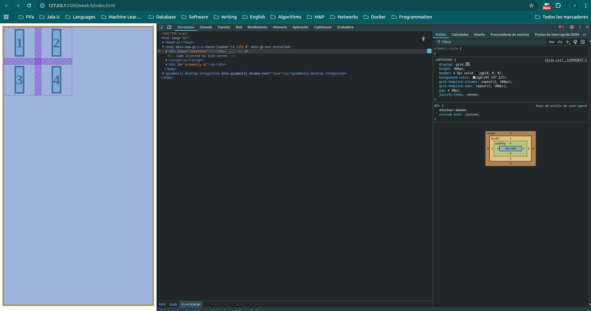

* **align-items**: Aligns items inside their cells vertically.

```css
.container {
  display: grid;
  align-items: center;
}
```

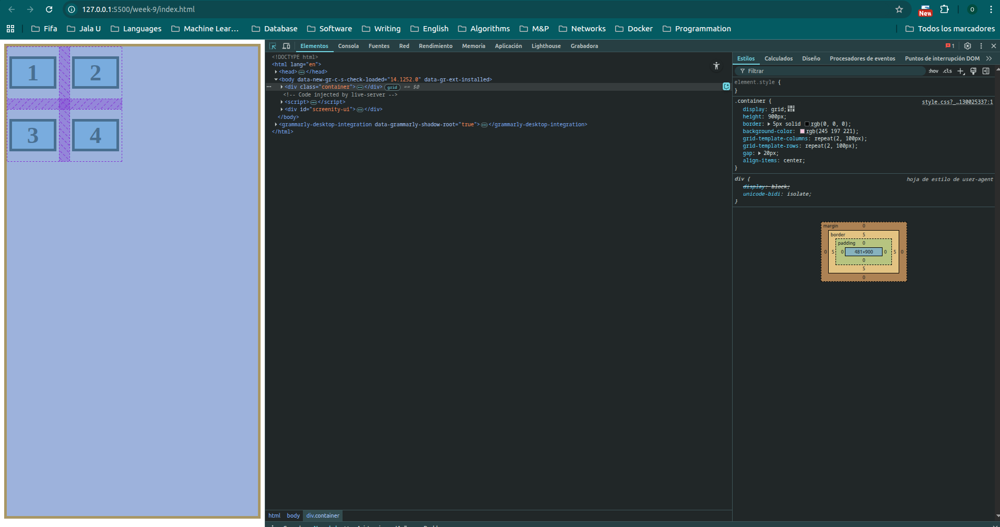

* **justify-content**: Aligns the whole grid horizontally inside the container.
* **align-content**: Aligns the whole grid vertically inside the container.

```css
.container {
  display: grid;
  grid-template-columns: repeat(3, 100px);
  justify-content: center;
  align-content: center;
  height: 500px;
}
```
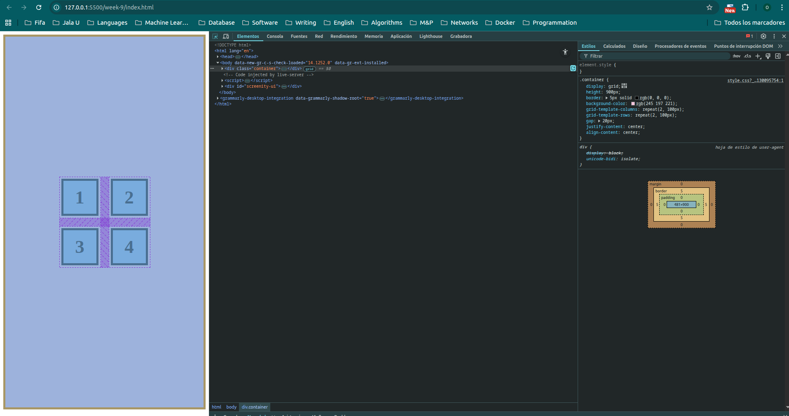


### Grid Item Properties

* **grid-column / grid-row**: Defines the position of an item in the grid.

```css
.item-1 {
  grid-column: 1 / 3; 
  grid-row: 1 / 2;   
}
```

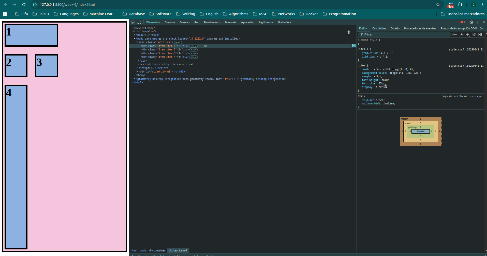

* **grid-area**: Shorthand for row/column start and end.

```css
.item-2 {
  grid-area: 2 / 1 / 3 / 3; 
}
```

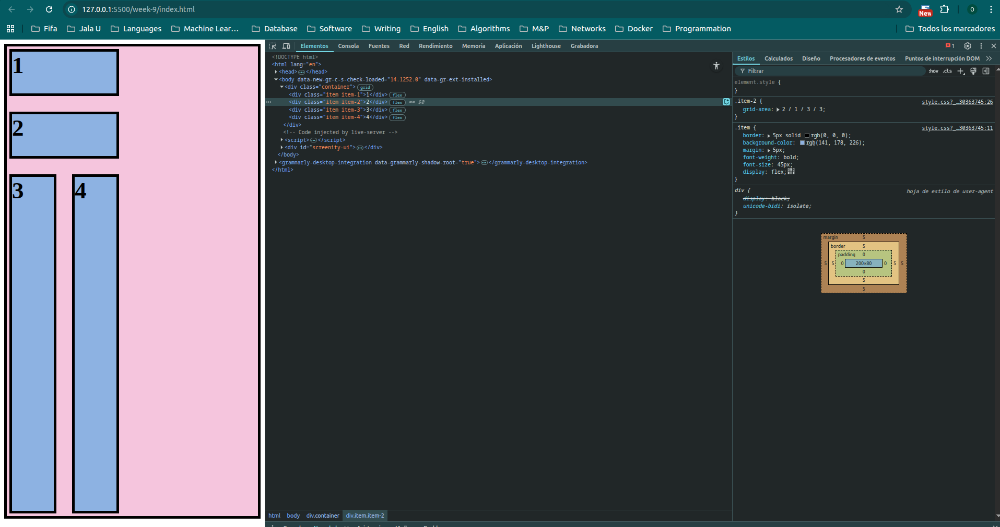

* **justify-self**: Aligns a single item horizontally within its cell.
* **align-self**: Aligns a single item vertically within its cell.

```css
.item-3 {
  justify-self: end;
  align-self: center;
}
```
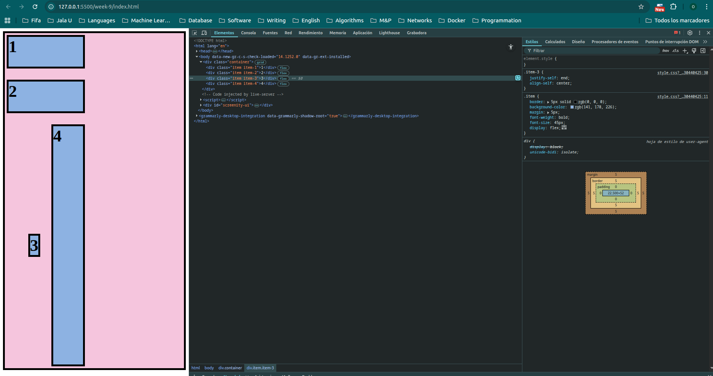

### Example in the project

Hotel cards with grid for hotels:

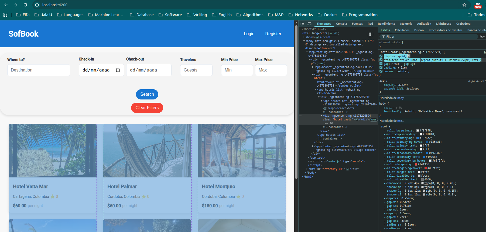

## Media Queries

CSS Media Queries are used to apply CSS styles according to the screen size.

- Media queries detect device features like screen width, height, and resolution.
- Breakpoints define the screen sizes where the design needs to change.
- They ensure a smooth, user-friendly experience across all devices.

**Sintax:**

```css
@media mediatype and (condition) {
  /* CSS styles */
}
```

Media types specify which devices the styles should apply to. Commonly used types include:

- **all:** Suitable for all media devices.
- **print:** Used for printers.
- **screen:** Targeted at computer screens, tablets, smartphones, etc.
- **speech:**	Designed for screen readers that read the content aloud.

### Example in the project

Search bar with media query:

```css
@media screen and (max-width: 768px) {
  max-width: 500px;
  border-radius: var(--radius-sm);
  gap: var(--gap-sm);
  padding: 1rem;
}

@media screen and (max-width: 390px) {
  max-width: 300px;
}
```

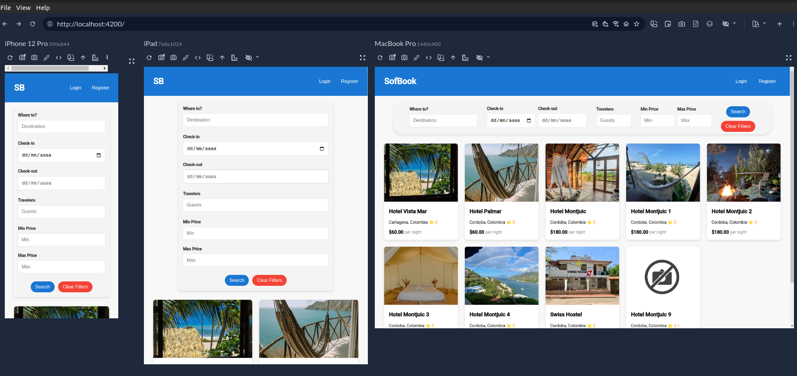


## Flexbox vs CSS Grid

* **Flexbox** is a one-dimensional layout system. It works along a single axis at a time either a row (horizontal) or a column (vertical). It’s best when we want to align items in a line, distribute space, or handle flexible content.
  *Example use cases:* navigation bars, buttons in a row, aligning form fields.

* **CSS Grid** is a two-dimensional layout system. It allows us to work with both rows and columns simultaneously. It’s best when we need a structured layout, like designing entire web pages or complex components.
  *Example use cases:* full-page layouts, ../images/image galleries, dashboards.

**When to use each:**

* Use **Flexbox** when arranging items in **one direction** (row OR column).
* Use **Grid** when arranging items in **two directions** (rows AND columns).

# Reference

- https://www.geeksforgeeks.org/css/css-flexbox-and-its-properties/
- https://www.geeksforgeeks.org/css/what-is-css-flexbox/
- https://www.geeksforgeeks.org/css/what-is-css-grid/
- https://www.geeksforgeeks.org/css/css-grid-property/
- https://www.geeksforgeeks.org/css/css-media-queries/